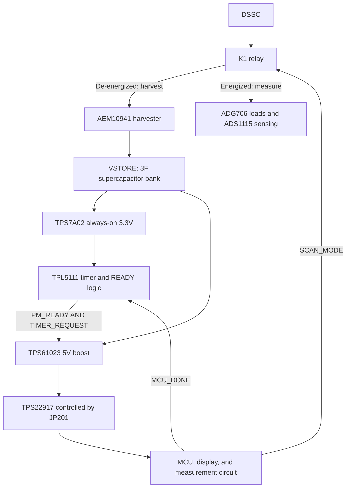

# IVcurve_tester — Basic and Charging Boards

An I–V measurement circuit for dye-sensitized solar cells (DSSCs) and other low-power photovoltaic devices. Both boards use a **LOLIN S3 Mini, ADG706 load multiplexer, ADS1115 ADC, and Adafruit 4814 e-paper display**.

## Design Credits

- The basic board derives from **Marc Dusseiller's ([@dusjagr](https://github.com/dusjagr)) [IVcurve_tester](https://github.com/dusjagr/IVcurve_tester)**, including its original I–V measurement architecture, hardware, and code. This derivative adapts the carrier, GPIO assignments, and display interface.
- The charging board's **energy-harvesting, storage, power-control, and derivative PCB design was completed by Sol 6.1**.
- The original MIT copyright is retained in [LICENSE](LICENSE). Additional component-library attribution is provided in [NOTICE](NOTICE.md).

## Electrical Overview

| Function | Basic Board | Charging Board |
|---|---|---|
| System power | USB | DSSC harvesting and a controlled 5V boost supply; USB maintenance input |
| DUT connection | One DSSC, positive and negative collector pads at J1 | Same single-DSSC interface |
| I–V load selection | ADG706, 16 resistive loads | ADG706, 16 resistive loads |
| Voltage measurement | ADS1115 | ADS1115 |
| Energy harvesting | — | AEM10941 |
| Energy storage | — | Two parallel 1.5F / 5V supercapacitor packs, 3F total |
| Main power control | USB-powered operation | READY and timer logic, TPS61023 boost, TPS22917 load switch |
| Harvest/measurement switching | DUT connected to the measurement circuit | K1 relay switches the DSSC between harvesting and measurement |

## Basic Board


USB powers the MCU, ADC, and display. The DSSC is the device under test, rather than the MCU's power source.

The ADG706 selects one of 16 load resistors. The ADS1115 measures the voltage at each load point, and the firmware calculates current and power:

```text
I = V / Rpath
P = V × I
```

`Rpath` includes the selected resistor, multiplexer on-resistance, traces, and contacts. The supplied firmware uses nominal resistor values until measured path resistances and ADC calibration are entered. The ADS1115's ±4.096V gain setting describes its conversion scale; the input must still comply with its supply-dependent electrical limits.

The display interface uses the Adafruit 4814 SSD1680 panel at 250 × 122 pixels. Measurement starts from the button or the serial `SCAN` command. See the [basic firmware instructions](firmware/basic/README.md) for operation and GPIO assignments.

## Charging Board


The charging circuit harvests energy from the DSSC and stores it in **supercapacitors**. C201 and C202 are 1.5F / 5V PHB packs connected in parallel: the nominal total capacitance is **3F**, and the voltage rating remains **5V**.



### Harvesting and Storage

With K1 de-energized, the DSSC positive terminal connects to `HARV_P` and the AEM10941. The measurement load and ADC sensing branch are disconnected by the relay contacts.

The AEM10941 converts harvested energy into stored energy at `VSTORE`. Its configuration pins are set to `CFG=000`, corresponding to the schematic's nominal **70% Voc** MPPT setting. This hardware harvesting setting is separate from the MCU's I–V sweep and measured maximum-power-point calculation.

R280–R283 configure the AEM10941's charge and discharge thresholds. These thresholds govern when charging is limited, when stored energy is ready for use, and when the system should stop drawing from storage.

### Main Supply Control

TPS7A02 supplies the always-on 3.3V control domain. The main supply enable is:

```text
BOOST_EN = PM_READY AND TIMER_REQUEST
```

TPL5111 is configured for a nominal interval of approximately 600 seconds. The timer interval schedules a power request; actual operation also depends on the stored-energy condition. TPS61023 boosts `VSTORE` to `SOLAR_5V`, and TPS22917 connects that supply to the module's VBUS when enabled through JP201.

### Measurement and Return to Harvesting

The charging controller requires the following sequence:

1. Disable the ADG706 load before changing the relay state.
2. Assert `SCAN_MODE` to energize K1. The DSSC then connects to `LOAD_P`, while the second relay pole connects it to `SENSE_P` for the ADC. The harvesting branch is disconnected during the sweep.
3. Wait for relay contacts and the analog input to settle, then scan the load resistors and read the ADS1115.
4. Disable the load and release K1 to reconnect the DSSC to the harvester.
5. Complete the required logging/display operation and signal `MCU_DONE` through the Schmitt buffer to end the main-power interval.

`POWER_WARN_N` provides a storage-related warning input for early termination. Firmware must handle this input, relay settling, and DONE timing. The supplied basic USB firmware does not implement this autonomous charging-control sequence.

| Charging control signal | MCU GPIO | Function |
|---|---:|---|
| `SCAN_MODE` | 12 | Select harvesting or measurement through K1 |
| `MCU_DONE` | 13 | End the timer-controlled main-power interval |
| `POWER_WARN_N` | 11 | Storage/power warning input |

### USB Power and Energy Budget

Set **JP201 to OFF before connecting USB**. JP201 controls the TPS22917 load-switch path between the harvested 5V supply and module VBUS. USB is used as a maintenance supply with that path disabled.

For a supercapacitor bank, usable energy between two storage voltages is:

```text
Eusable = 0.5 × C × (Vhigh² − Vlow²)
C ≈ 3F
```

Charging time depends on DSSC output, illumination, conversion efficiency, capacitor leakage, and always-on consumption. The energy budget must include MCU activity, the relay coil, ADC operation, and display refresh. The timer's short off interval without a DONE signal must also be considered when designing the power-down and restart sequence.

## Circuit References

| | Basic Board | Charging Board |
|---|---|---|
| KiCad 10 project | [Open](hardware/basic/Marc_USB.kicad_pro) | [Open](hardware/charging/Marc_USB.kicad_pro) |
| Schematic | [PDF](hardware/basic/schematic.pdf) | [PDF](hardware/charging/schematic.pdf) |
| BOM | [CSV](hardware/basic/BOM.csv) | [CSV](hardware/charging/BOM.csv) |
| Pin/net map | [CSV](hardware/basic/checks/pin-map.csv) | [CSV](hardware/charging/checks/pin-map.csv) |
| Fabrication files | [Gerber ZIP](hardware/basic/fabrication/basic-JLCPCB.zip) | [Gerber ZIP](hardware/charging/fabrication/charging-PROTOTYPE-JLCPCB.zip) |
