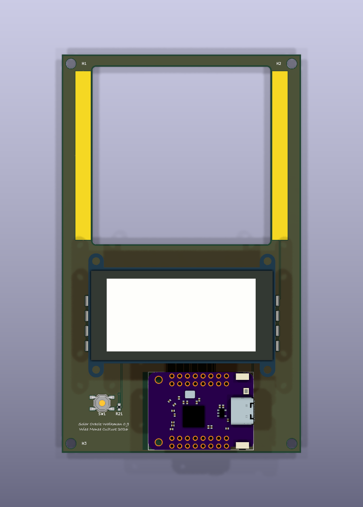
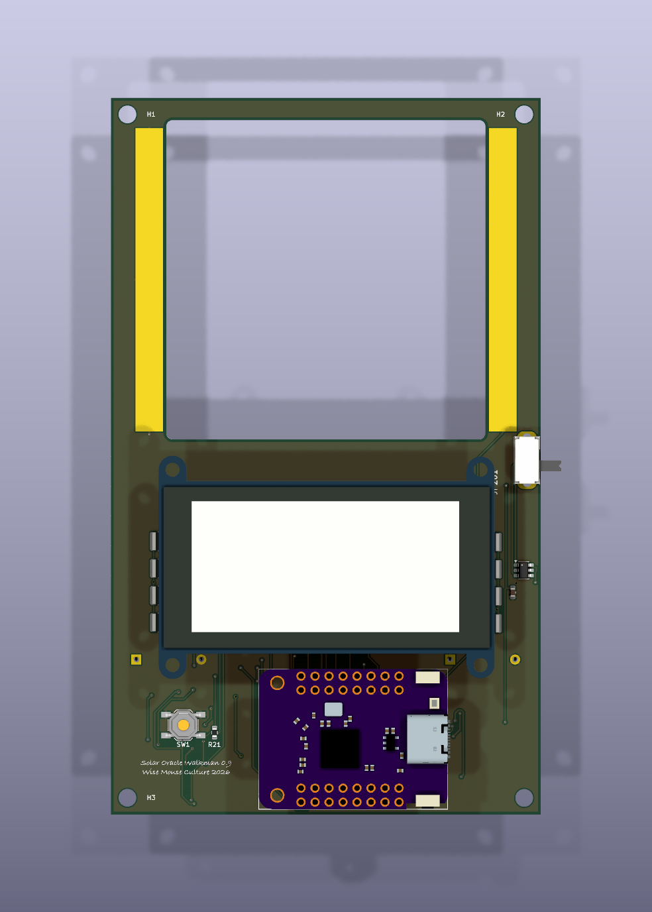
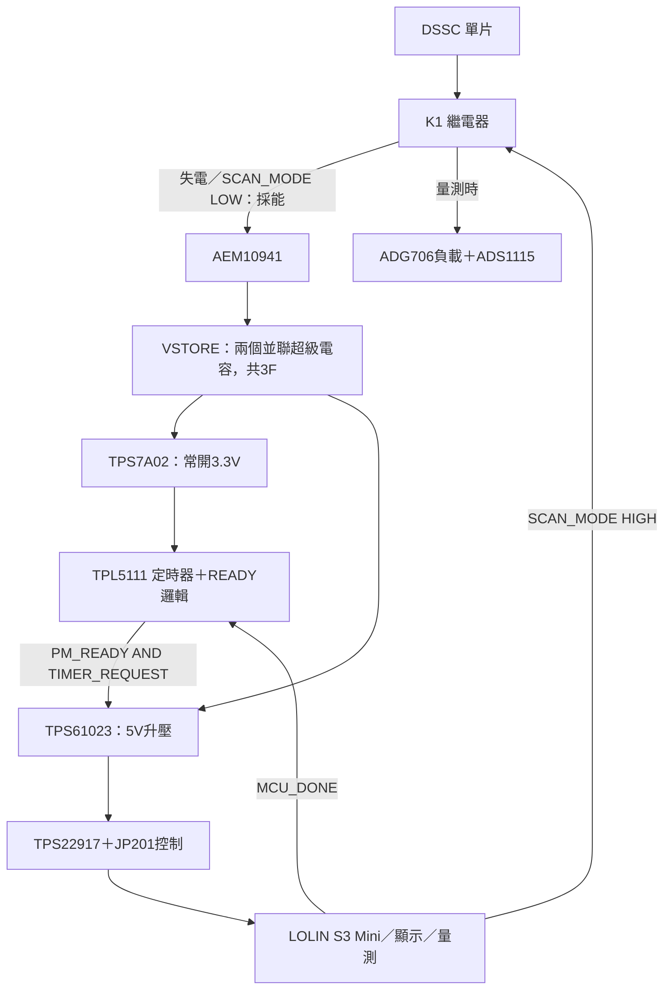

# IVcurve_tester — 基本款與充電版

以染料敏化太陽能電池（DSSC）等低功率光伏元件為對象的 I–V 量測板。本儲存庫集中發布兩套 **KiCad 10 硬體工程、製板包與必要文件**。

## 來源與設計貢獻

- **基本款的原始 I–V 量測架構、程式與硬體源自 Marc Dusseiller（[@dusjagr](https://github.com/dusjagr)）的 [IVcurve_tester](https://github.com/dusjagr/IVcurve_tester) repo。** 本 repo 是該專案的 fork；MIT 授權與原作者著作權保留於 [LICENSE](LICENSE)。
- 本地基本款是針對 LOLIN S3 Mini、ADG706、ADS1115 與 Adafruit 4814 顯示板整理的衍生載板，接腳與顯示配置有調整。
- **充電版的採能／儲能、電源控制與 PCB 衍生設計由 Sol 6.1 完成。** 專案由 Shih-Wei Chieh / weiweiweiopen 維護。
- 設計完成與硬體驗證是不同階段；兩款在此均以原型狀態發布，詳細檢查結果見下方。其他模型與函式庫來源見 [NOTICE](NOTICE.md)。

## 選擇版本

| | 基本款／非充電版 | 充電／採能版 |
|---|---|---|
| KiCad 工程 | [hardware/basic/Marc_USB.kicad_pro](hardware/basic/Marc_USB.kicad_pro) | [hardware/charging/Marc_USB.kicad_pro](hardware/charging/Marc_USB.kicad_pro) |
| 製板包 | [basic-JLCPCB.zip](hardware/basic/fabrication/basic-JLCPCB.zip) | [charging-PROTOTYPE-JLCPCB.zip](hardware/charging/fabrication/charging-PROTOTYPE-JLCPCB.zip) |
| 原理圖閱讀版 | [PDF](hardware/basic/schematic.pdf) | [PDF](hardware/charging/schematic.pdf) |
| BOM | [basic BOM](hardware/basic/BOM.csv) | [charging BOM](hardware/charging/BOM.csv) |
| MCU／量測 | LOLIN S3 Mini、ADG706、ADS1115 | 相同量測核心，增加採能與供電切換 |
| 系統供電 | USB | DSSC → 超級電容 → 5V 升壓；另有 USB 維護模式 |
| 儲能／充電 | 無 | AEM10941＋兩個並聯 1.5F／5V 超級電容 |
| 韌體 | [基本款量測程式](firmware/basic/README.md)，已編譯 | 尚未隨本次發布提供完整自動循環韌體 |

兩款均為單片 DSSC 接口：J1 的正、負集電焊盤；PCB 為 2 層。兩套工程各自保留必要的 project-local 元件庫與模型；需安裝 KiCad 10 的標準符號／封裝／3D library。

### 基本款



USB 供應 MCU、ADC 與顯示模組。DSSC 作為被測元件，透過 ADG706 選擇 16 個負載阻值；ADS1115 讀取電壓，再依負載計算 I–V 點。此款沒有自動充電或儲能電路。

隨附的獨立韌體使用 Adafruit 4814／SSD1680 250×122 三色顯示，按鍵或 Serial `SCAN` 啟動量測。目前電流仍以名義負載或使用者填入的校準阻值估算；MUX 導通電阻、接點與整機校準需實測，不能把估算電流當作已校準儀器規格。

### 充電版



這裡的「充電」是 **DSSC 能量採集並儲入超級電容**。儲能元件為 C201、C202 兩個 1.5F／5V PHB 封裝，並聯後名義總容量 **3F、耐壓仍為5V**。



#### 充電與量測循環

1. **預設採能**：K1 未激磁時，DSSC 正端接到 `HARV_P`，進入 AEM10941。量測負載與 ADC 取樣支路由繼電器接點移開。
2. **採能與儲能**：AEM10941 處理光伏能量轉換與儲能管理；此設計 `CFG=000`，原理圖設定的 MPPT 工作比為約 **70% Voc**。這是採能晶片的設定，與 MCU 掃 I–V 曲線找出 MPP 的量測程序分開。
3. **累積能量**：超級電容的 `VSTORE` 上升。過充、ready 與放電界限由 AEM10941 與 R280–R283 網路設定；實際門檻、公差與單片 DSSC 的充電速度須量測。
4. **有條件啟動主系統**：TPS7A02 供應常開控制域；TPL5111 名義約600秒設定與 `PM_READY` 經邏輯閘共同允許 TPS61023 啟動，產生 `SOLAR_5V`。600秒是定時器設定，**不保證每10分鐘一定有足夠能量完成量測**。
5. **暫停採能來量測**：韌體先停用 ADG706 負載，再令 `SCAN_MODE` 拉高，使 K1 把 DSSC 切到 `LOAD_P`，並把另一組接點接到 `SENSE_P`／ADC。等待繼電器與輸入穩定後才掃描負載；掃描時採能支路斷開，避免充電負載混入 I–V 曲線。
6. **回到採能**：掃描後停用負載、釋放繼電器，再經 `MCU_DONE`／Schmitt buffer 回報定時器結束主系統供電，回到低耗電等待。完整韌體還需處理 `POWER_WARN_N`、低電壓退出、顯示更新與 DONE 時序。

對應 MCU 腳：`SCAN_MODE=GPIO12`、`MCU_DONE=GPIO13`、`POWER_WARN_N=GPIO11`。目前隨附的基本款程式沒有這套完整控制流程，不能直接把它當作充電版自動循環韌體。

#### USB 維護模式與能量預算

- **插 USB 前先將 JP201 設為 OFF**，關閉採能5V到模組 VBUS 的負載開關路徑。這是手動維護模式；目前未宣稱完成自動 USB／採能電源切換驗證。
- TPL5111 若沒有收到 DONE，其短暫 off 行為不能替代已驗證的整個量測／休眠流程；斷電、重新啟動及放電時間仍需上板確認。
- 可用能量估算為 `E = ½ × C × (Vhigh² − Vlow²)`；此處 `C≈3F`。充電時間取決於光照、DSSC實際功率、轉換效率、電容漏電及常開域耗電，並非固定時間。

## 發布狀態

本次製板 ZIP 已從**本次發布的 PCB**重新匯出，並保留來源 SHA256。沒有使用舊目錄中與目前PCB來源雜湊不一致的製板包。

| 原生檢查 | 基本款 | 充電版 |
|---|---:|---:|
| ERC | 0 | 0 |
| 未連接項目 | 0 | 0 |
| 原理圖／PCB parity | 0 | 0 |
| DRC courtyard overlap errors | 10 | 10 |
| 絲印／文字 warnings | 5 | 9 |

這些重疊涉及 ESP32 模組與下方元件，沿用**母座架高、底下約15mm淨空**的裝配假設；實際母座外形、背面件與高度公差尚未驗證。因此這是原型板發布，**不是DRC全零或已完成實機充電／量測循環的量產認證**。原生完整報告在各版本的 `checks/`，BOM 仍需實際備料／封裝核對。

## 最小目錄

```text
hardware/
  basic/       # 非充電版KiCad、必要庫／模型、BOM、PDF、製板包與檢查
  charging/    # 充電版相同交付結構
firmware/
  basic/       # 已配合基本款接腳的獨立PlatformIO程式與必要函式庫
tools/         # KiCad匯出與來源一致性工具
README.md
NOTICE.md
LICENSE
```

Blender、整機外殼、研究資料、歷史備份、其他硬體版本與 `.pio` 編譯快取不包含在本次發布內容。原 repo 既有軟體歷史仍可透過 Git 歷史查閱。

重新匯出兩板：安裝KiCad10後執行 `python3 tools/export_hardware.py`。基本款編譯：`pio run -d firmware/basic`。下載製板檔可使用上方連結或本 repo 的 [Releases](https://github.com/weiweiweiopen/IVcurve_tester/releases)。
